# HP-MDS — Phase 3 results (auto-generated)

All numbers are on the vehicle-grouped test split unless stated. ± = std over seeds. Models marked * were trained on a stratified subsample (secondary baselines).

## Dataset and splits

| Split | Windows | Vehicles | Benign windows | Attack windows |
|---|---|---|---|---|
| tr | 361,137 | 14,591 | 213,321 | 147,816 |
| va | 300,425 | 4,863 | 174,915 | 125,510 |
| te | 300,913 | 4,873 | 176,876 | 124,037 |

## Exp A — in-distribution, binary detection (attack vs benign)

| Model | Accuracy | Precision | Recall | F1 | MCC | ROC-AUC | PR-AUC | FPR | FNR | Seeds |
|---|---|---|---|---|---|---|---|---|---|---|
| HP-MDS | 0.9597 ± 0.0001 | 0.9999 ± 0.0001 | 0.9023 ± 0.0001 | 0.9486 ± 0.0001 | 0.9188 ± 0.0001 | 0.9319 ± 0.0006 | 0.9541 ± 0.0002 | 0.0000 ± 0.0000 | 0.0977 ± 0.0001 | 5 |
| RandomForest | 0.9669 ± 0.0012 | 0.9704 ± 0.0032 | 0.9486 ± 0.0002 | 0.9593 ± 0.0014 | 0.9315 ± 0.0026 | 0.9750 ± 0.0001 | 0.9805 ± 0.0000 | 0.0203 ± 0.0022 | 0.0514 ± 0.0002 | 5 |
| XGBoost | 0.9780 ± 0.0001 | 0.9986 ± 0.0001 | 0.9479 ± 0.0000 | 0.9726 ± 0.0001 | 0.9551 ± 0.0001 | 0.9745 ± 0.0001 | 0.9803 ± 0.0001 | 0.0009 ± 0.0001 | 0.0521 ± 0.0000 | 5 |
| Bi-LSTM | 0.9777 ± 0.0004 | 0.9986 ± 0.0009 | 0.9472 ± 0.0003 | 0.9722 ± 0.0004 | 0.9545 ± 0.0008 | 0.9747 ± 0.0002 | 0.9805 ± 0.0001 | 0.0009 ± 0.0006 | 0.0528 ± 0.0003 | 5 |
| LSTM-AE | 0.8950 ± 0.0047 | 0.9085 ± 0.0250 | 0.8302 ± 0.0216 | 0.8670 ± 0.0044 | 0.7834 ± 0.0094 | 0.9118 ± 0.0015 | 0.9311 ± 0.0017 | 0.0596 ± 0.0205 | 0.1698 ± 0.0216 | 5 |
| IsolationForest | 0.8438 ± 0.0067 | 0.8565 ± 0.0280 | 0.7476 ± 0.0174 | 0.7978 ± 0.0060 | 0.6761 ± 0.0156 | 0.8750 ± 0.0047 | 0.8914 ± 0.0040 | 0.0888 ± 0.0203 | 0.2524 ± 0.0174 | 5 |
| Physics-only | 0.9580 ± 0.0000 | 0.9992 ± 0.0000 | 0.8989 ± 0.0000 | 0.9464 ± 0.0000 | 0.9155 ± 0.0000 | 0.9303 ± 0.0000 | 0.9535 ± 0.0000 | 0.0005 ± 0.0000 | 0.1011 ± 0.0000 | 5 |
| KNN-Bagging* | 0.9314 | 0.9873 | 0.8445 | 0.9103 | 0.8622 | 0.9390 | 0.9455 | 0.0076 | 0.1555 | 1 |
| Stacked* | 0.9785 | 0.9999 | 0.9478 | 0.9732 | 0.9562 | 0.9749 | 0.9805 | 0.0000 | 0.0522 | 1 |

## Exp A — multi-class identification

| Model | Accuracy | Macro-F1 | Weighted-F1 | Balanced acc. | MCC | Params | Size (MB) | Train time (s) |
|---|---|---|---|---|---|---|---|---|
| HP-MDS | 0.9082 ± 0.0003 | 0.7315 ± 0.0021 | 0.8929 ± 0.0006 | 0.7269 ± 0.0017 | 0.8547 ± 0.0005 | 38,044 | 0.16 ± 0.00 | 48 ± 7 |
| RandomForest | 0.9225 ± 0.0012 | 0.8273 ± 0.0006 | 0.9208 ± 0.0005 | 0.8252 ± 0.0007 | 0.8789 ± 0.0017 | – | 311.44 ± 4.17 | 59 ± 7 |
| XGBoost | 0.9326 ± 0.0001 | 0.8283 ± 0.0003 | 0.9255 ± 0.0001 | 0.8235 ± 0.0003 | 0.8940 ± 0.0002 | – | 35.17 ± 1.30 | 71 ± 16 |
| Bi-LSTM | 0.9316 ± 0.0008 | 0.8198 ± 0.0034 | 0.9238 ± 0.0009 | 0.8188 ± 0.0028 | 0.8926 ± 0.0012 | 44,052 | 1.34 ± 0.00 | 25 ± 1 |
| KNN-Bagging* | 0.8702 | 0.6572 | 0.8509 | 0.6285 | 0.7906 | – | 49.61 | 7 |
| Stacked* | 0.9325 | 0.8255 | 0.9251 | 0.8206 | 0.8938 | – | 556.02 | 76 |

## Exp A — detection rate per attack type (mean over seeds)

| Attack | HP-MDS | RandomForest | XGBoost | Bi-LSTM | LSTM-AE | IsolationForest | Physics-only | KNN-Bagging* | Stacked* |
|---|---|---|---|---|---|---|---|---|---|
| ConstPos | 0.870 ± 0.001 | 1.000 ± 0.000 | 1.000 ± 0.000 | 1.000 ± 0.000 | 0.786 ± 0.016 | 0.326 ± 0.046 | 0.857 ± 0.000 | 0.147 | 1.000 |
| ConstPosOffset | 0.000 ± 0.000 | 0.011 ± 0.003 | 0.001 ± 0.000 | 0.001 ± 0.001 | 0.062 ± 0.020 | 0.090 ± 0.022 | 0.000 ± 0.000 | 0.010 | 0.000 |
| RandomPos | 1.000 ± 0.000 | 1.000 ± 0.000 | 1.000 ± 0.000 | 1.000 ± 0.000 | 1.000 ± 0.000 | 0.984 ± 0.027 | 1.000 ± 0.000 | 1.000 | 1.000 |
| RandomPosOffset | 1.000 ± 0.000 | 1.000 ± 0.000 | 1.000 ± 0.000 | 1.000 ± 0.000 | 0.615 ± 0.120 | 0.477 ± 0.123 | 1.000 ± 0.000 | 0.057 | 1.000 |
| ConstSpeed | 0.989 ± 0.001 | 0.999 ± 0.001 | 0.997 ± 0.000 | 0.985 ± 0.004 | 0.965 ± 0.009 | 0.602 ± 0.064 | 0.968 ± 0.000 | 0.894 | 1.000 |
| ConstSpeedOffset | 0.997 ± 0.002 | 0.995 ± 0.001 | 0.997 ± 0.000 | 0.998 ± 0.001 | 0.946 ± 0.017 | 0.345 ± 0.044 | 0.926 ± 0.000 | 0.578 | 0.993 |
| RandomSpeed | 1.000 ± 0.000 | 1.000 ± 0.000 | 1.000 ± 0.000 | 1.000 ± 0.000 | 1.000 ± 0.000 | 1.000 ± 0.000 | 1.000 ± 0.000 | 1.000 | 1.000 |
| RandomSpeedOffset | 1.000 ± 0.000 | 1.000 ± 0.000 | 1.000 ± 0.000 | 1.000 ± 0.000 | 1.000 ± 0.000 | 0.960 ± 0.033 | 1.000 ± 0.000 | 0.868 | 1.000 |
| EventualStop | 0.053 ± 0.001 | 0.874 ± 0.000 | 0.873 ± 0.000 | 0.868 ± 0.003 | 0.044 ± 0.005 | 0.041 ± 0.010 | 0.054 ± 0.000 | 0.505 | 0.872 |
| Disruptive | 0.989 ± 0.000 | 0.989 ± 0.000 | 0.989 ± 0.000 | 0.989 ± 0.000 | 0.989 ± 0.000 | 0.988 ± 0.001 | 0.989 ± 0.000 | 0.959 | 0.989 |
| DataReplay | 0.997 ± 0.000 | 0.994 ± 0.001 | 0.994 ± 0.000 | 0.992 ± 0.001 | 0.987 ± 0.002 | 0.984 ± 0.006 | 0.998 ± 0.000 | 0.836 | 0.995 |
| DelayedMessages | 0.074 ± 0.000 | 0.575 ± 0.003 | 0.566 ± 0.000 | 0.564 ± 0.003 | 0.206 ± 0.206 | 0.109 ± 0.008 | 0.074 ± 0.000 | 0.564 | 0.566 |
| DoS | 1.000 ± 0.000 | 1.000 ± 0.000 | 1.000 ± 0.000 | 1.000 ± 0.000 | 0.552 ± 0.087 | 0.252 ± 0.038 | 1.000 ± 0.000 | 0.990 | 1.000 |
| DoSRandom | 1.000 ± 0.000 | 1.000 ± 0.000 | 1.000 ± 0.000 | 1.000 ± 0.000 | 1.000 ± 0.000 | 1.000 ± 0.000 | 1.000 ± 0.000 | 1.000 | 1.000 |
| DoSDisruptive | 1.000 ± 0.000 | 1.000 ± 0.000 | 1.000 ± 0.000 | 1.000 ± 0.000 | 0.994 ± 0.001 | 0.988 ± 0.002 | 1.000 ± 0.000 | 0.999 | 1.000 |
| GridSybil | 1.000 ± 0.000 | 1.000 ± 0.000 | 1.000 ± 0.000 | 1.000 ± 0.000 | 0.887 ± 0.011 | 0.898 ± 0.020 | 1.000 ± 0.000 | 0.998 | 1.000 |
| DataReplaySybil | 0.996 ± 0.000 | 0.995 ± 0.000 | 0.995 ± 0.000 | 0.992 ± 0.001 | 0.987 ± 0.002 | 0.986 ± 0.004 | 0.997 ± 0.000 | 0.850 | 0.995 |
| DoSRandomSybil | 1.000 ± 0.000 | 1.000 ± 0.000 | 1.000 ± 0.000 | 1.000 ± 0.000 | 1.000 ± 0.000 | 1.000 ± 0.000 | 1.000 ± 0.000 | 1.000 | 1.000 |
| DoSDisruptiveSybil | 1.000 ± 0.000 | 1.000 ± 0.000 | 1.000 ± 0.000 | 1.000 ± 0.000 | 0.986 ± 0.005 | 0.978 ± 0.002 | 1.000 ± 0.000 | 0.996 | 1.000 |

## Exp A — per-class F1 (multi-class)

| Class | HP-MDS | RandomForest | XGBoost | Bi-LSTM | KNN-Bagging* | Stacked* |
|---|---|---|---|---|---|---|
| Genuine | 0.967 ± 0.000 | 0.972 ± 0.001 | 0.982 ± 0.000 | 0.981 ± 0.000 | 0.944 | 0.982 |
| ConstPos | 0.928 ± 0.001 | 1.000 ± 0.000 | 1.000 ± 0.000 | 0.944 ± 0.005 | 0.246 | 0.999 |
| ConstPosOffset | 0.000 ± 0.000 | 0.010 ± 0.002 | 0.000 ± 0.000 | 0.000 ± 0.000 | 0.001 | 0.000 |
| RandomPos | 1.000 ± 0.000 | 1.000 ± 0.000 | 1.000 ± 0.000 | 1.000 ± 0.000 | 0.996 | 1.000 |
| RandomPosOffset | 0.999 ± 0.000 | 0.998 ± 0.000 | 0.998 ± 0.000 | 0.994 ± 0.001 | 0.106 | 0.998 |
| ConstSpeed | 0.950 ± 0.004 | 0.997 ± 0.001 | 0.997 ± 0.000 | 0.945 ± 0.014 | 0.838 | 0.993 |
| ConstSpeedOffset | 0.960 ± 0.004 | 0.994 ± 0.001 | 0.997 ± 0.000 | 0.957 ± 0.011 | 0.658 | 0.988 |
| RandomSpeed | 0.999 ± 0.000 | 1.000 ± 0.000 | 1.000 ± 0.000 | 0.998 ± 0.000 | 0.987 | 1.000 |
| RandomSpeedOffset | 0.998 ± 0.001 | 0.999 ± 0.000 | 0.999 ± 0.000 | 0.996 ± 0.002 | 0.910 | 0.999 |
| EventualStop | 0.098 ± 0.002 | 0.932 ± 0.000 | 0.932 ± 0.000 | 0.867 ± 0.012 | 0.545 | 0.931 |
| Disruptive | 0.911 ± 0.003 | 0.810 ± 0.002 | 0.840 ± 0.001 | 0.872 ± 0.012 | 0.652 | 0.804 |
| DataReplay | 0.273 ± 0.172 | 0.470 ± 0.006 | 0.478 ± 0.004 | 0.444 ± 0.080 | 0.363 | 0.483 |
| DelayedMessages | 0.137 ± 0.001 | 0.684 ± 0.004 | 0.710 ± 0.002 | 0.718 ± 0.005 | 0.715 | 0.722 |
| DoS | 0.985 ± 0.000 | 0.985 ± 0.001 | 0.984 ± 0.000 | 0.985 ± 0.001 | 0.923 | 0.983 |
| DoSRandom | 0.836 ± 0.000 | 0.839 ± 0.000 | 0.834 ± 0.001 | 0.834 ± 0.001 | 0.806 | 0.831 |
| DoSDisruptive | 0.828 ± 0.001 | 0.826 ± 0.001 | 0.814 ± 0.001 | 0.825 ± 0.001 | 0.789 | 0.821 |
| GridSybil | 0.995 ± 0.000 | 0.994 ± 0.000 | 0.996 ± 0.000 | 0.992 ± 0.001 | 0.941 | 0.995 |
| DataReplaySybil | 0.181 ± 0.220 | 0.459 ± 0.005 | 0.475 ± 0.003 | 0.468 ± 0.071 | 0.350 | 0.444 |
| DoSRandomSybil | 0.812 ± 0.004 | 0.816 ± 0.000 | 0.804 ± 0.001 | 0.813 ± 0.001 | 0.726 | 0.801 |
| DoSDisruptiveSybil | 0.774 ± 0.003 | 0.763 ± 0.001 | 0.728 ± 0.002 | 0.763 ± 0.005 | 0.648 | 0.736 |

## Comparison with existing research (quoted numbers — not like-for-like)

| Study | Data / protocol | Task | Reported result | Like-for-like? |
|---|---|---|---|---|
| **HP-MDS (ours)** | VeReMi Ext., vehicle-grouped 60/20/20 | Binary / 20-class | F1 0.9486 ± 0.0001, macro-F1 0.7315 ± 0.0021 | — |
| E1 VeMisNet (Bi-LSTM) | VeReMi Ext., 500K subset, random 80/20 | Multi-class | Acc 99.81% (abstract) / 91.80% (body) | No — different split/subset/classes |
| E5 HyperLSTM | VeReMi Ext., 3.19M, chronological 80/20 | Binary | Acc 98%, F1 ≈0.98, 0.6 ms | No — different split/subset/classes |
| E7 ABC stacked ensemble | VeReMi/F2MD, 22M, stratified | 19-class | Acc 0.94, F1 0.93 | No — different split/subset/classes |
| E8 Fed-LSTM-AE | VeReMi, non-IID clients | Binary | F1 0.963, ROC-AUC 0.966 | No — different split/subset/classes |
| E4 Fed VAE+GMM | VeReMi (5 position attacks) | Binary | F1 0.775, precision 0.672 | No — different split/subset/classes |
| E9 LA-DETECTS | VeReMi Ext. high density | Per-attack | see per-attack table | No — different split/subset/classes |

### Per-attack F1 vs E9 LA-DETECTS (same dataset family; E9 values quoted from the paper)

| Attack | E9 F1 (%) | HP-MDS F1 (%) |
|---|---|---|
| ConstSpeedOffset | 99.46 | 95.97 ± 0.37 |
| DoSDisruptiveSybil | 97.36 | 77.39 ± 0.30 |
| ConstPosOffset | 64.45 | 0.00 ± 0.00 |
| EventualStop | 63.69 | 9.84 ± 0.21 |
| GridSybil | 60.24 | 99.53 ± 0.04 |
| DelayedMessages | 74.45 | 13.67 ± 0.05 |
| DataReplay | 80.19 | 27.29 ± 17.20 |
| DoS | 99.9 | 98.51 ± 0.01 |
| DoSRandom | 99.9 | 83.62 ± 0.03 |
| DoSDisruptive | 99.9 | 82.83 ± 0.06 |

## Statistical tests (seed 0 predictions; CIs by vehicle-level bootstrap, 1,000 resamples)

| Model | Binary F1 [95% CI] | Macro-F1 [95% CI] |
|---|---|---|
| Bi-LSTM | 0.9720 [0.9668, 0.9772] | 0.8215 [0.8102, 0.8301] |
| HP-MDS | 0.9485 [0.9405, 0.9558] | 0.7335 [0.7219, 0.7424] |
| IsolationForest | 0.8060 [0.7896, 0.8203] | – |
| KNN-Bagging* | 0.9103 [0.9000, 0.9191] | 0.6572 [0.6440, 0.6667] |
| LSTM-AE | 0.8680 [0.8559, 0.8801] | – |
| Physics-only | 0.9464 [0.9384, 0.9536] | – |
| RandomForest | 0.9614 [0.9560, 0.9667] | 0.8269 [0.8161, 0.8356] |
| Stacked* | 0.9732 [0.9679, 0.9782] | 0.8255 [0.8156, 0.8335] |
| XGBoost | 0.9727 [0.9676, 0.9777] | 0.8278 [0.8178, 0.8359] |

| HP-MDS vs | McNemar χ² | p (Holm) | Wilcoxon p (Holm), per-attack detection | Mean Δ detection |
|---|---|---|---|---|
| Bi-LSTM | 4916.9 | 0.00e+00 | 0.692 | -0.075 |
| IsolationForest | 32658.8 | 0.00e+00 | 0.0778 | +0.156 |
| KNN-Bagging* | 4485.8 | 0.00e+00 | 0.53 | +0.090 |
| LSTM-AE | 18032.0 | 0.00e+00 | 0.336 | +0.050 |
| Physics-only | 465.9 | 2.54e-103 | 0.692 | +0.005 |
| RandomForest | 829.1 | 5.09e-182 | 0.53 | -0.077 |
| Stacked* | 5574.6 | 0.00e+00 | 0.692 | -0.076 |
| XGBoost | 5191.8 | 0.00e+00 | 0.692 | -0.076 |

## Exp D — open-set (attack types held out of training)

**Hold-out 1: ConstPosOffset, ConstSpeedOffset, DataReplay, GridSybil**

| Model | Unseen recall | Unseen recall @5% FPR | AUROC benign-vs-unseen | Known recall | FPR | Known macro-F1 | Unseen → 'unknown' | Unseen → known class |
|---|---|---|---|---|---|---|---|---|
| HP-MDS | 0.853 ± 0.001 | 0.861 ± 0.000 | 0.928 ± 0.000 | 0.917 ± 0.000 | 0.000 ± 0.000 | 0.819 ± 0.001 | 0.067 ± 0.020 | 0.785 ± 0.020 |
| RandomForest | 0.747 ± 0.003 | 0.803 ± 0.003 | 0.914 ± 0.001 | 0.977 ± 0.000 | 0.001 ± 0.000 | 0.910 ± 0.000 | 0.000 ± 0.000 | 0.747 ± 0.003 |
| XGBoost | 0.728 ± 0.002 | 0.794 ± 0.004 | 0.900 ± 0.001 | 0.977 ± 0.000 | 0.000 ± 0.000 | 0.910 ± 0.000 | 0.000 ± 0.000 | 0.728 ± 0.002 |
| Bi-LSTM | 0.840 ± 0.004 | 0.857 ± 0.002 | 0.927 ± 0.001 | 0.976 ± 0.001 | 0.002 ± 0.001 | 0.906 ± 0.003 | 0.000 ± 0.000 | 0.840 ± 0.004 |
| LSTM-AE | 0.783 ± 0.004 | 0.783 ± 0.004 | 0.890 ± 0.001 | 0.831 ± 0.008 | 0.049 ± 0.000 | – | – | – |
| IsolationForest | 0.673 ± 0.013 | 0.673 ± 0.013 | 0.876 ± 0.005 | 0.727 ± 0.008 | 0.049 ± 0.000 | – | – | – |
| Physics-only | 0.844 ± 0.000 | 0.857 ± 0.000 | 0.927 ± 0.000 | 0.916 ± 0.000 | 0.001 ± 0.000 | – | – | – |

**Hold-out 2: RandomPos, RandomSpeedOffset, DelayedMessages, DoSDisruptive**

| Model | Unseen recall | Unseen recall @5% FPR | AUROC benign-vs-unseen | Known recall | FPR | Known macro-F1 | Unseen → 'unknown' | Unseen → known class |
|---|---|---|---|---|---|---|---|---|
| HP-MDS | 0.872 ± 0.000 | 0.875 ± 0.000 | 0.907 ± 0.001 | 0.910 ± 0.000 | 0.000 ± 0.000 | 0.749 ± 0.006 | 0.044 ± 0.008 | 0.828 ± 0.008 |
| RandomForest | 0.934 ± 0.003 | 0.943 ± 0.000 | 0.974 ± 0.000 | 0.950 ± 0.000 | 0.015 ± 0.002 | 0.829 ± 0.001 | 0.000 ± 0.000 | 0.934 ± 0.003 |
| XGBoost | 0.865 ± 0.004 | 0.932 ± 0.005 | 0.970 ± 0.001 | 0.950 ± 0.000 | 0.000 ± 0.000 | 0.833 ± 0.001 | 0.000 ± 0.000 | 0.865 ± 0.004 |
| Bi-LSTM | 0.936 ± 0.003 | 0.942 ± 0.001 | 0.971 ± 0.001 | 0.949 ± 0.000 | 0.001 ± 0.000 | 0.817 ± 0.005 | 0.000 ± 0.000 | 0.936 ± 0.003 |
| LSTM-AE | 0.872 ± 0.000 | 0.872 ± 0.000 | 0.957 ± 0.007 | 0.806 ± 0.009 | 0.049 ± 0.000 | – | – | – |
| IsolationForest | 0.846 ± 0.013 | 0.842 ± 0.008 | 0.896 ± 0.002 | 0.691 ± 0.020 | 0.059 ± 0.021 | – | – | – |
| Physics-only | 0.872 ± 0.000 | 0.876 ± 0.000 | 0.904 ± 0.000 | 0.906 ± 0.000 | 0.001 ± 0.000 | – | – | – |

**Hold-out 3: ConstPos, EventualStop, DoSRandom, DataReplaySybil**

| Model | Unseen recall | Unseen recall @5% FPR | AUROC benign-vs-unseen | Known recall | FPR | Known macro-F1 | Unseen → 'unknown' | Unseen → known class |
|---|---|---|---|---|---|---|---|---|
| HP-MDS | 0.817 ± 0.003 | 0.834 ± 0.000 | 0.849 ± 0.001 | 0.922 ± 0.000 | 0.000 ± 0.000 | 0.833 ± 0.001 | 0.042 ± 0.007 | 0.775 ± 0.009 |
| RandomForest | 0.854 ± 0.007 | 0.968 ± 0.007 | 0.986 ± 0.001 | 0.940 ± 0.000 | 0.009 ± 0.001 | 0.872 ± 0.000 | 0.000 ± 0.000 | 0.854 ± 0.007 |
| XGBoost | 0.848 ± 0.004 | 0.932 ± 0.008 | 0.977 ± 0.002 | 0.940 ± 0.000 | 0.001 ± 0.000 | 0.873 ± 0.000 | 0.000 ± 0.000 | 0.848 ± 0.004 |
| Bi-LSTM | 0.808 ± 0.002 | 0.830 ± 0.007 | 0.903 ± 0.011 | 0.939 ± 0.000 | 0.000 ± 0.000 | 0.876 ± 0.000 | 0.000 ± 0.000 | 0.808 ± 0.002 |
| LSTM-AE | 0.813 ± 0.003 | 0.811 ± 0.002 | 0.842 ± 0.001 | 0.835 ± 0.026 | 0.060 ± 0.021 | – | – | – |
| IsolationForest | 0.724 ± 0.012 | 0.719 ± 0.010 | 0.836 ± 0.010 | 0.723 ± 0.021 | 0.059 ± 0.021 | – | – | – |
| Physics-only | 0.827 ± 0.000 | 0.833 ± 0.000 | 0.845 ± 0.000 | 0.918 ± 0.000 | 0.001 ± 0.000 | – | – | – |

### Open-set rejection AUROC (known attack vs unseen attack), mean over hold-outs and seeds

| Model | Energy | Fused-score | MSP | MSP+Fused (rank avg) |
|---|---|---|---|---|
| HP-MDS | 0.562 ± 0.065 | 0.487 ± 0.070 | 0.546 ± 0.075 | 0.558 ± 0.114 |
| RandomForest | – | – | 0.716 ± 0.115 | – |
| XGBoost | – | – | 0.713 ± 0.062 | – |
| Bi-LSTM | 0.593 ± 0.108 | – | 0.606 ± 0.085 | – |

## Exp E — noise and packet-loss robustness (binary F1 / FPR, seed-0 models, test split)

| Condition | HP-MDS | RandomForest | XGBoost | Bi-LSTM | LSTM-AE | Physics-only |
|---|---|---|---|---|---|---|
| clean | 0.949 / 0.000 | 0.961 / 0.017 | 0.973 / 0.001 | 0.972 / 0.001 | 0.868 / 0.049 | 0.946 / 0.001 |
| pos1_spd0.2 | 0.842 / 0.223 | 0.931 / 0.009 | 0.934 / 0.001 | 0.941 / 0.023 | 0.868 / 0.050 | 0.873 / 0.149 |
| pos3_spd0.5 | 0.589 / 0.978 | 0.889 / 0.074 | 0.871 / 0.104 | 0.874 / 0.149 | 0.868 / 0.053 | 0.594 / 0.957 |
| pos5_spd1 | 0.584 / 1.000 | 0.766 / 0.318 | 0.663 / 0.615 | 0.739 / 0.443 | 0.867 / 0.065 | 0.584 / 1.000 |
| pos10_spd2 | 0.584 / 1.000 | 0.585 / 0.964 | 0.585 / 0.993 | 0.588 / 0.979 | 0.810 / 0.208 | 0.584 / 1.000 |
| drop10% | 0.955 / 0.000 | 0.866 / 0.177 | 0.841 / 0.228 | 0.927 / 0.059 | 0.846 / 0.085 | 0.670 / 0.648 |
| drop30% | 0.942 / 0.016 | 0.692 / 0.604 | 0.664 / 0.697 | 0.738 / 0.428 | 0.704 / 0.381 | 0.594 / 0.969 |
| pos3_spd0.5+drop10% | 0.589 / 0.978 | 0.797 / 0.246 | 0.728 / 0.403 | 0.810 / 0.278 | 0.844 / 0.092 | 0.588 / 0.985 |

## Exp F — efficiency (single CPU thread, one window per call)

| Model | Median latency (ms) | p95 latency (ms) | Throughput (windows/s, batched) | Params | Size (MB) | Within 100 ms? |
|---|---|---|---|---|---|---|
| HP-MDS | 1.549 | 3.087 | 31,847 | 38044 | 0.160 | yes |
| HP-MDS (Stage 1 only) | 0.881 | 1.043 | 69,292 | 14792 | – | yes |
| RandomForest | 5.111 | 7.205 | 50,333 | – | 315.229 | yes |
| XGBoost | 9.247 | 16.879 | 6,853 | – | 35.054 | yes |
| Bi-LSTM | 0.428 | 1.072 | 54,636 | 44052 | 0.179 | yes |
| LSTM-AE | 0.839 | 2.021 | 40,993 | 66186 | 0.270 | yes |
| IsolationForest | 12.105 | 20.978 | 119,914 | – | 2.850 | yes |
| Physics-only | 0.021 | 0.034 | 1,142,472 | 0 | 0.000 | yes |

HP-MDS flags 37.2% of test windows, so Stage 2 runs only on that share.

## Ablation studies (mean ± std over seeds)

**components**

| Variant | F1 | Precision | Recall | FPR | ROC-AUC | Macro-F1 |
|---|---|---|---|---|---|---|
| Stage1: AE score only | 0.9481 ± 0.0000 | 0.9987 ± 0.0001 | 0.9025 ± 0.0000 | 0.0008 ± 0.0000 | 0.9332 ± 0.0004 | – |
| Stage1: physics score only | 0.9464 ± 0.0000 | 0.9992 ± 0.0000 | 0.8989 ± 0.0000 | 0.0005 ± 0.0000 | 0.9303 ± 0.0000 | – |
| Stage1: fused (alpha=0.6) | 0.9481 ± 0.0001 | 0.9987 ± 0.0001 | 0.9023 ± 0.0001 | 0.0008 ± 0.0000 | 0.9317 ± 0.0003 | – |
| Stage1+Stage2, no open-set | 0.9486 ± 0.0000 | 1.0000 ± 0.0000 | 0.9023 ± 0.0001 | 0.0000 ± 0.0000 | – | 0.7464 ± 0.0052 |
| Stage2 only (closed-set clf) | 0.9726 ± 0.0004 | 0.9986 ± 0.0008 | 0.9479 ± 0.0001 | 0.0009 ± 0.0005 | – | 0.8159 ± 0.0053 |
| Full HP-MDS | 0.9486 ± 0.0000 | 0.9999 ± 0.0001 | 0.9023 ± 0.0001 | 0.0000 ± 0.0000 | 0.9317 ± 0.0003 | 0.7335 ± 0.0030 |
| HP-MDS + confident Stage2 alarms (union) | 0.9729 ± 0.0001 | 0.9997 ± 0.0001 | 0.9475 ± 0.0003 | 0.0002 ± 0.0001 | – | 0.8037 ± 0.0029 |
| Stage1: fused (alpha=0.7) | 0.9482 | 0.9988 | 0.9025 | 0.0008 | 0.9318 | – |

**features**

| Variant | F1 | Precision | Recall | FPR | ROC-AUC | Macro-F1 |
|---|---|---|---|---|---|---|
| AE on FV-A | 0.8214 ± 0.0031 | 0.8475 ± 0.0008 | 0.7968 ± 0.0052 | 0.1005 ± 0.0005 | 0.8903 ± 0.0046 | – |
| AE on FV-A + physics fusion | 0.9464 ± 0.0000 | 0.9992 ± 0.0000 | 0.8989 ± 0.0000 | 0.0005 ± 0.0000 | 0.9303 ± 0.0000 | – |
| AE on FV-B | 0.9156 ± 0.0010 | 0.9856 ± 0.0001 | 0.8549 ± 0.0017 | 0.0088 ± 0.0001 | 0.9294 ± 0.0005 | – |
| AE on FV-B + physics fusion | 0.9464 ± 0.0000 | 0.9992 ± 0.0000 | 0.8989 ± 0.0000 | 0.0005 ± 0.0000 | 0.9303 ± 0.0000 | – |
| AE on FV-C | 0.9481 ± 0.0001 | 0.9987 ± 0.0001 | 0.9024 ± 0.0001 | 0.0008 ± 0.0001 | 0.9328 ± 0.0004 | – |
| AE on FV-C + physics fusion | 0.9480 ± 0.0001 | 0.9987 ± 0.0001 | 0.9022 ± 0.0001 | 0.0008 ± 0.0001 | 0.9312 ± 0.0002 | – |

**latent**

| Variant | F1 | Precision | Recall | FPR | ROC-AUC | Macro-F1 |
|---|---|---|---|---|---|---|
| latent=8 | 0.9480 ± 0.0000 | 0.9987 ± 0.0000 | 0.9022 ± 0.0001 | 0.0008 ± 0.0000 | 0.9323 ± 0.0003 | – |
| latent=32 | 0.9481 ± 0.0000 | 0.9988 ± 0.0000 | 0.9023 ± 0.0000 | 0.0008 ± 0.0000 | 0.9309 ± 0.0001 | – |

**imbalance**

| Variant | F1 | Precision | Recall | FPR | ROC-AUC | Macro-F1 |
|---|---|---|---|---|---|---|
| Stage2 none | 0.9486 ± 0.0001 | 1.0000 ± 0.0000 | 0.9021 ± 0.0002 | 0.0000 ± 0.0000 | 0.9315 ± 0.0004 | 0.7315 ± 0.0018 |
| Stage2 smote | 0.9485 ± 0.0000 | 1.0000 ± 0.0000 | 0.9020 ± 0.0000 | 0.0000 ± 0.0000 | 0.9312 ± 0.0002 | 0.7293 ± 0.0017 |

**xgb_phys**

| Variant | F1 | Precision | Recall | FPR | ROC-AUC | Macro-F1 |
|---|---|---|---|---|---|---|
| XGBoost FV-B | 0.9726 ± 0.0001 | 0.9986 ± 0.0001 | 0.9479 ± 0.0000 | 0.0009 ± 0.0001 | 0.9745 ± 0.0001 | 0.8283 ± 0.0003 |
| XGBoost FV-C | 0.9730 ± 0.0001 | 0.9991 ± 0.0002 | 0.9483 ± 0.0000 | 0.0006 ± 0.0001 | 0.9744 ± 0.0001 | 0.8314 ± 0.0003 |

**window**

| Variant | F1 | Precision | Recall | FPR | ROC-AUC | Macro-F1 |
|---|---|---|---|---|---|---|
| w=5 | 0.9448 ± 0.0001 | 0.9998 ± 0.0001 | 0.8956 ± 0.0001 | 0.0001 ± 0.0001 | 0.9274 ± 0.0004 | 0.7185 ± 0.0029 |
| w=15 | 0.9510 ± 0.0001 | 1.0000 ± 0.0000 | 0.9067 ± 0.0002 | 0.0000 ± 0.0000 | 0.9353 ± 0.0009 | 0.7400 ± 0.0034 |
| w=20 | 0.9535 ± 0.0000 | 1.0000 ± 0.0000 | 0.9111 ± 0.0001 | 0.0000 ± 0.0000 | 0.9379 ± 0.0001 | 0.7478 ± 0.0037 |

## Exp C — cross-dataset (train VeReMi Extension → test original VeReMi; shared fields)

| Model | In-dist F1 | Cross F1 | Drop | Cross precision | Cross recall | Cross FPR | Cross ROC-AUC |
|---|---|---|---|---|---|---|---|
| HP-MDS | 0.949 ± 0.000 | 0.799 ± 0.019 | 0.150 ± 0.019 | 0.891 ± 0.051 | 0.725 ± 0.002 | 0.023 ± 0.012 | 0.848 ± 0.003 |
| RandomForest | 0.950 ± 0.002 | 0.632 ± 0.008 | 0.318 ± 0.009 | 0.508 ± 0.010 | 0.837 ± 0.001 | 0.205 ± 0.009 | 0.850 ± 0.003 |
| XGBoost | 0.972 ± 0.000 | 0.499 ± 0.001 | 0.473 ± 0.001 | 0.349 ± 0.001 | 0.875 ± 0.000 | 0.412 ± 0.001 | 0.837 ± 0.002 |
| Bi-LSTM | 0.972 ± 0.000 | 0.496 ± 0.009 | 0.477 ± 0.008 | 0.344 ± 0.009 | 0.886 ± 0.005 | 0.428 ± 0.019 | 0.879 ± 0.007 |
| LSTM-AE | 0.923 ± 0.001 | 0.506 ± 0.002 | 0.417 ± 0.002 | 0.373 ± 0.003 | 0.787 ± 0.004 | 0.334 ± 0.006 | 0.792 ± 0.002 |
| IsolationForest | 0.805 ± 0.007 | 0.425 ± 0.024 | 0.380 ± 0.028 | 0.345 ± 0.039 | 0.560 ± 0.022 | 0.275 ± 0.049 | 0.724 ± 0.008 |
| Physics-only | 0.946 ± 0.000 | 0.785 ± 0.000 | 0.161 ± 0.000 | 0.870 ± 0.000 | 0.715 ± 0.000 | 0.027 ± 0.000 | 0.837 ± 0.000 |

| Original-VeReMi attack | HP-MDS | RandomForest | XGBoost | Bi-LSTM | LSTM-AE | IsolationForest | Physics-only |
|---|---|---|---|---|---|---|---|
| ConstPos | 0.799 ± 0.002 | 1.000 ± 0.000 | 1.000 ± 0.000 | 0.999 ± 0.001 | 0.803 ± 0.007 | 0.266 ± 0.039 | 0.770 ± 0.000 |
| ConstPosOffset | 0.021 ± 0.011 | 0.216 ± 0.008 | 0.412 ± 0.001 | 0.436 ± 0.021 | 0.327 ± 0.006 | 0.262 ± 0.047 | 0.025 ± 0.000 |
| RandomPos | 1.000 ± 0.000 | 1.000 ± 0.000 | 1.000 ± 0.000 | 1.000 ± 0.000 | 1.000 ± 0.000 | 1.000 ± 0.000 | 1.000 ± 0.000 |
| RandomPosOffset | 1.000 ± 0.000 | 1.000 ± 0.000 | 1.000 ± 0.000 | 1.000 ± 0.000 | 1.000 ± 0.000 | 1.000 ± 0.000 | 1.000 ± 0.000 |
| EventualStop | 0.807 ± 0.002 | 0.969 ± 0.003 | 0.965 ± 0.000 | 0.998 ± 0.002 | 0.807 ± 0.008 | 0.271 ± 0.039 | 0.780 ± 0.000 |

## Exp B — traffic-density shift (off-peak hours vs rush hours 07-09 & 17-19)

**Train offpeak → test rush**

| Model | Source F1 | Target F1 | Drop | Target precision | Target recall | Target FPR | Target macro-F1 |
|---|---|---|---|---|---|---|---|
| HP-MDS | 0.948 ± 0.000 | 0.949 ± 0.000 | -0.001 ± 0.000 | 1.000 ± 0.000 | 0.903 ± 0.000 | 0.000 ± 0.000 | 0.733 ± 0.001 |
| RandomForest | 0.962 ± 0.002 | 0.963 ± 0.002 | -0.001 ± 0.000 | 0.979 ± 0.004 | 0.948 ± 0.000 | 0.013 ± 0.002 | 0.837 ± 0.001 |
| XGBoost | 0.973 ± 0.000 | 0.972 ± 0.000 | 0.001 ± 0.000 | 0.998 ± 0.000 | 0.947 ± 0.000 | 0.001 ± 0.000 | 0.838 ± 0.000 |
| Bi-LSTM | 0.970 ± 0.002 | 0.970 ± 0.002 | 0.001 ± 0.001 | 0.994 ± 0.005 | 0.947 ± 0.001 | 0.004 ± 0.003 | 0.821 ± 0.003 |
| LSTM-AE | 0.846 ± 0.003 | 0.833 ± 0.003 | 0.012 ± 0.000 | 0.843 ± 0.001 | 0.824 ± 0.004 | 0.100 ± 0.001 | – |
| IsolationForest | 0.798 ± 0.007 | 0.790 ± 0.007 | 0.008 ± 0.001 | 0.829 ± 0.003 | 0.755 ± 0.010 | 0.101 ± 0.001 | – |
| Physics-only | 0.946 ± 0.000 | 0.947 ± 0.000 | -0.001 ± 0.000 | 0.999 ± 0.000 | 0.900 ± 0.000 | 0.000 ± 0.000 | – |

**Train rush → test offpeak**

| Model | Source F1 | Target F1 | Drop | Target precision | Target recall | Target FPR | Target macro-F1 |
|---|---|---|---|---|---|---|---|
| HP-MDS | 0.949 ± 0.000 | 0.948 ± 0.000 | 0.001 ± 0.000 | 1.000 ± 0.000 | 0.901 ± 0.001 | 0.000 ± 0.000 | 0.722 ± 0.004 |
| RandomForest | 0.969 ± 0.000 | 0.971 ± 0.000 | -0.002 ± 0.000 | 0.995 ± 0.001 | 0.948 ± 0.000 | 0.004 ± 0.001 | 0.814 ± 0.001 |
| XGBoost | 0.971 ± 0.000 | 0.973 ± 0.000 | -0.001 ± 0.000 | 0.998 ± 0.000 | 0.948 ± 0.000 | 0.001 ± 0.000 | 0.813 ± 0.001 |
| Bi-LSTM | 0.971 ± 0.001 | 0.971 ± 0.001 | 0.000 ± 0.000 | 0.997 ± 0.001 | 0.946 ± 0.000 | 0.002 ± 0.001 | 0.798 ± 0.007 |
| LSTM-AE | 0.829 ± 0.003 | 0.839 ± 0.003 | -0.009 ± 0.001 | 0.853 ± 0.001 | 0.825 ± 0.005 | 0.107 ± 0.001 | – |
| IsolationForest | 0.796 ± 0.004 | 0.796 ± 0.005 | 0.001 ± 0.003 | 0.913 ± 0.002 | 0.705 ± 0.007 | 0.050 ± 0.001 | – |
| Physics-only | 0.947 ± 0.000 | 0.946 ± 0.000 | 0.001 ± 0.000 | 0.999 ± 0.000 | 0.898 ± 0.000 | 0.001 ± 0.000 | – |

## Timeliness — detection delay per attacker stream (seed-0 models, stride-1 windows)

| Model | Attacker streams detected | Median delay (msgs) | p90 delay (msgs) | Median delay (s) | p90 delay (s) | Benign streams with any alarm |
|---|---|---|---|---|---|---|
| HP-MDS | 0.912 (1339/1469) | 10 | 10 | 9.0 | 9.0 | 0.000 (0/3404) |
| RandomForest | 0.958 (1407/1469) | 10 | 10 | 9.0 | 9.0 | 0.353 (1201/3404) |
| XGBoost | 0.948 (1392/1469) | 10 | 10 | 9.0 | 9.0 | 0.055 (188/3404) |
| Bi-LSTM | 0.947 (1391/1469) | 10 | 10 | 9.0 | 9.0 | 0.050 (169/3404) |
| Physics-only | 0.912 (1339/1469) | 10 | 10 | 9.0 | 9.0 | 0.009 (31/3404) |

A window needs 10 messages, so the minimum possible delay is 10 messages.

## Error / failure analysis

**HP-MDS failure taxonomy (test windows, seed 0)**

| Category | Windows |
|---|---|
| (a) missed subtle/small-offset attacks | 11,500 |
| (a') missed other attacks | 668 |
| (b) benign windows flagged | 0 |
| (c) benign flagged with irregular beacon gap (>1.1 s) | 0 |
| (d) attack assigned the wrong attack class | 10,319 |
| (e) attack labelled 'unknown' | 5,192 |
| correct | 273,234 |
| total | 300,913 |

**Missed-attack rate / false-positive rate by mean speed (m/s)**

| Bin | Windows | HP-MDS | RandomForest | XGBoost | Bi-LSTM | Physics-only |
|---|---|---|---|---|---|---|
| <2 | 39,509 | 0.404 / 0.0000 | 0.046 / 0.0026 | 0.046 / 0.0000 | 0.048 / 0.0067 | 0.406 / 0.0005 |
| 2-8 | 40,427 | 0.027 / 0.0000 | 0.027 / 0.0011 | 0.027 / 0.0000 | 0.028 / 0.0000 | 0.028 / 0.0015 |
| 8-14 | 149,206 | 0.104 / 0.0000 | 0.102 / 0.0263 | 0.104 / 0.0010 | 0.105 / 0.0000 | 0.110 / 0.0002 |
| 14-20 | 39,675 | 0.081 / 0.0000 | 0.076 / 0.0023 | 0.076 / 0.0014 | 0.079 / 0.0002 | 0.087 / 0.0011 |
| 20-30 | 15,387 | 0.000 / – | 0.000 / – | 0.000 / – | 0.000 / – | 0.000 / – |
| >30 | 16,709 | 0.000 / – | 0.000 / – | 0.000 / – | 0.000 / – | 0.000 / – |

**Missed-attack rate / false-positive rate by mean beacon gap (s)**

| Bin | Windows | HP-MDS | RandomForest | XGBoost | Bi-LSTM | Physics-only |
|---|---|---|---|---|---|---|
| <0.3 | 38,815 | 0.000 / – | 0.000 / – | 0.000 / – | 0.000 / – | 0.000 / – |
| 0.3-0.9 | 33,171 | 0.000 / – | 0.000 / – | 0.000 / – | 0.000 / – | 0.000 / – |
| 0.9-1.1 | 228,927 | 0.234 / 0.0000 | 0.123 / 0.0172 | 0.124 / 0.0008 | 0.127 / 0.0009 | 0.241 / 0.0005 |
| 1.1-2 | 0 | – / – | – / – | – / – | – / – | – / – |
| >2 | 0 | – / – | – / – | – / – | – / – | – / – |

**Stage-1 autoencoder: per-feature reconstruction error (attack / benign)**

| Feature | Benign | Attack | Ratio |
|---|---|---|---|
| r_time | 0.0000 | 57.9981 | 57998146057.13 |
| r_amax | 0.0000 | 34.0246 | 34024604797.36 |
| r_vmax | 0.0000 | 0.8185 | 818546056.75 |
| rate | 0.0005 | 69.5762 | 131126.08 |
| dt | 0.0008 | 47.5916 | 61746.91 |
| rel_x | 0.0192 | 19.2652 | 1003.39 |
| rel_y | 0.0196 | 18.3666 | 935.88 |
| dpos | 0.0186 | 6.8374 | 367.19 |
| r_head_vel | 0.0419 | 13.4443 | 320.92 |
| r_implied_v | 0.1809 | 44.9781 | 248.68 |
| v | 0.0306 | 5.4814 | 178.88 |
| r_head_move | 0.2239 | 20.5401 | 91.72 |
| vx | 0.0465 | 3.9823 | 85.61 |
| r_cv_pred | 0.2423 | 19.8300 | 81.85 |
| r_disp | 0.4937 | 37.0377 | 75.02 |
| dv | 0.1372 | 10.2555 | 74.73 |
| vy | 0.0622 | 3.6788 | 59.14 |
| r_acc | 0.6240 | 29.7421 | 47.66 |
| dhead | 0.2127 | 9.4083 | 44.23 |
| hx | 0.0422 | 1.6224 | 38.43 |
| hy | 0.0529 | 1.3149 | 24.84 |
| a | 0.2167 | 3.4129 | 15.75 |
| ay | 0.2912 | 3.1265 | 10.74 |
| ax | 0.3302 | 3.5138 | 10.64 |

**XGBoost top-20 features (gain importance)**

| Feature | Importance |
|---|---|
| max(rate) | 0.6289 |
| min(rate) | 0.1143 |
| mean(rate) | 0.0865 |
| min(dt) | 0.0437 |
| mean(dt) | 0.0391 |
| std(dpos) | 0.0092 |
| mean(dpos) | 0.0072 |
| max(dpos) | 0.0070 |
| min(ax) | 0.0057 |
| min(dpos) | 0.0050 |
| mean(v) | 0.0039 |
| std(rate) | 0.0036 |
| std(dv) | 0.0036 |
| mean(dhead) | 0.0030 |
| max(dv) | 0.0026 |
| max(v) | 0.0024 |
| min(v) | 0.0019 |
| min(dhead) | 0.0018 |
| std(vx) | 0.0018 |
| std(ax) | 0.0017 |

## ONNX export (onnxruntime, single CPU thread, one window)

| Model part | Median (ms) | p95 (ms) | Size (KB) | Max |diff| vs PyTorch |
|---|---|---|---|---|
| HP-MDS Stage1 AE | 0.0616 | 0.0828 | 63 | 4.8e-07 |
| HP-MDS Stage2 classifier | 0.0464 | 0.1158 | 94 | 2.9e-06 |
| Bi-LSTM | 0.0634 | 0.0829 | 174 | 2.9e-06 |
| LSTM-AE | 0.1054 | 0.1509 | 266 | 2.8e-02 |

## Exp E (extension) — timestamp jitter (binary F1 / FPR, seed-0 models)

| Jitter σ (s) | HP-MDS | RandomForest | XGBoost | Bi-LSTM | LSTM-AE | Physics-only |
|---|---|---|---|---|---|---|
| 0.0 | 0.949 / 0.000 | 0.961 / 0.017 | 0.973 / 0.001 | 0.972 / 0.001 | 0.868 / 0.049 | 0.946 / 0.001 |
| 0.02 | 0.956 / 0.026 | 0.961 / 0.017 | 0.959 / 0.021 | 0.970 / 0.003 | 0.868 / 0.049 | 0.584 / 1.000 |
| 0.05 | 0.912 / 0.095 | 0.961 / 0.017 | 0.959 / 0.021 | 0.961 / 0.013 | 0.868 / 0.049 | 0.584 / 1.000 |
| 0.1 | 0.858 / 0.192 | 0.957 / 0.024 | 0.959 / 0.021 | 0.947 / 0.032 | 0.868 / 0.049 | 0.584 / 1.000 |
| 0.2 | 0.707 / 0.549 | 0.923 / 0.078 | 0.953 / 0.030 | 0.913 / 0.085 | 0.869 / 0.049 | 0.584 / 1.000 |

## Adversarial sanity check (G6) — attack-window detection rate under feature-space perturbation

ε is in units of each raw feature's training standard deviation; PGD = 10-step white-box attack pushing windows towards 'benign'. Rows 'PGD vs X' are white-box for X and transferred to the other models. Feature-space attacks need not be physically realisable — this is a sanity check only.

| ε | Perturbation | HP-MDS | RandomForest | XGBoost | Bi-LSTM | LSTM-AE | Physics-only |
|---|---|---|---|---|---|---|---|
| 0.0 | clean | 0.903 | 0.949 | 0.949 | 0.947 | 0.825 | 0.899 |
| 0.01 | random noise | 0.947 | 0.902 | 0.928 | 0.943 | 0.825 | 1.000 |
| 0.01 | PGD vs HP-MDS | 0.918 | 0.940 | 0.953 | 0.941 | 0.823 | 0.888 |
| 0.01 | PGD vs Bi-LSTM | 0.903 | 0.926 | 0.953 | 0.929 | 0.824 | 0.899 |
| 0.05 | random noise | 0.965 | 0.938 | 0.988 | 0.994 | 0.845 | 1.000 |
| 0.05 | PGD vs HP-MDS | 0.863 | 0.933 | 0.976 | 0.944 | 0.824 | 0.866 |
| 0.05 | PGD vs Bi-LSTM | 0.904 | 0.941 | 0.970 | 0.907 | 0.844 | 0.899 |
| 0.1 | random noise | 0.977 | 0.997 | 1.000 | 1.000 | 0.896 | 1.000 |
| 0.1 | PGD vs HP-MDS | 0.828 | 0.970 | 0.992 | 0.954 | 0.849 | 0.929 |
| 0.1 | PGD vs Bi-LSTM | 0.910 | 0.952 | 0.984 | 0.925 | 0.862 | 0.899 |
| 0.25 | random noise | 0.983 | 1.000 | 1.000 | 1.000 | 1.000 | 1.000 |
| 0.25 | PGD vs HP-MDS | 0.848 | 0.993 | 0.994 | 0.966 | 0.943 | 0.955 |
| 0.25 | PGD vs Bi-LSTM | 0.940 | 0.981 | 0.991 | 0.942 | 0.989 | 0.899 |
| 0.5 | random noise | 0.987 | 1.000 | 1.000 | 1.000 | 1.000 | 1.000 |
| 0.5 | PGD vs HP-MDS | 0.835 | 0.992 | 0.991 | 0.991 | 0.999 | 0.958 |
| 0.5 | PGD vs Bi-LSTM | 0.937 | 0.989 | 0.996 | 0.930 | 1.000 | 0.899 |

## Permutation importance (60k test windows; base Stage-2 macro-F1 0.827, base Stage-1 F1 0.948)

| Feature | Stage-2 macro-F1 drop | Stage-1 F1 drop |
|---|---|---|
| r_cv_pred | 0.2394 | 0.1404 |
| rate | 0.2332 | 0.1322 |
| dpos | 0.2098 | 0.0514 |
| r_acc | 0.1871 | 0.1182 |
| r_disp | 0.1469 | 0.1872 |
| r_time | 0.1381 | 0.1329 |
| r_implied_v | 0.1275 | 0.1812 |
| r_head_vel | 0.1273 | 0.0770 |
| dt | 0.1184 | 0.1323 |
| v | 0.1077 | 0.0257 |
| r_head_move | 0.0968 | 0.1354 |
| vy | 0.0841 | 0.0019 |
| rel_x | 0.0673 | 0.0812 |
| vx | 0.0637 | 0.0031 |
| dhead | 0.0598 | 0.0695 |
| r_amax | 0.0551 | 0.1335 |
| a | 0.0533 | 0.0001 |
| hy | 0.0514 | 0.0003 |
| hx | 0.0496 | 0.0004 |
| rel_y | 0.0436 | 0.0808 |
| dv | 0.0425 | 0.0107 |
| ay | 0.0151 | 0.0000 |
| ax | 0.0083 | 0.0002 |
| r_vmax | 0.0019 | 0.0170 |

## Peak extra inference memory (CPU, 1 thread, batch of 8,192 windows)

| Model | Peak extra memory (MB) | Per window (KB) |
|---|---|---|
| HP-MDS | 134.3 | 16.39 |
| RandomForest | 12.2 | 1.49 |
| XGBoost | 11.7 | 1.42 |
| Bi-LSTM | 108.2 | 13.20 |
| LSTM-AE | 31.3 | 3.82 |
| Physics-only | 11.9 | 1.46 |

## Open-set classification rate (OSCR; known-attack correct classification vs unseen-attack acceptance)

| Model | Hold-out 1 | Hold-out 2 | Hold-out 3 | Mean |
|---|---|---|---|---|
| HP-MDS | 0.442 | 0.611 | 0.624 | 0.559 |
| RandomForest | 0.650 | 0.769 | 0.558 | 0.659 |
| XGBoost | 0.616 | 0.672 | 0.762 | 0.683 |
| Bi-LSTM | 0.508 | 0.601 | 0.663 | 0.591 |

## Robustness check — windows per pseudonym instead of per vehicle (Exp A setting)

| Model | Binary F1 | MCC | FPR | Macro-F1 | Seeds |
|---|---|---|---|---|---|
| HP-MDS | 0.9202 ± 0.0002 | 0.8854 ± 0.0003 | 0.0009 ± 0.0000 | 0.7084 ± 0.0027 | 3 |
| RandomForest | 0.8923 ± 0.0027 | 0.8274 ± 0.0046 | 0.0828 ± 0.0039 | 0.8008 ± 0.0004 | 3 |
| XGBoost | 0.9541 ± 0.0001 | 0.9313 ± 0.0001 | 0.0012 ± 0.0001 | 0.8109 ± 0.0023 | 3 |
| Bi-LSTM | 0.9496 ± 0.0022 | 0.9244 ± 0.0038 | 0.0037 ± 0.0027 | 0.7980 ± 0.0043 | 3 |
| LSTM-AE | 0.8206 ± 0.0026 | 0.7297 ± 0.0110 | 0.0663 ± 0.0243 | – | 3 |
| IsolationForest | 0.7297 ± 0.0048 | 0.5973 ± 0.0060 | 0.0995 ± 0.0008 | – | 3 |
| Physics-only | 0.9168 ± 0.0000 | 0.8811 ± 0.0000 | 0.0005 ± 0.0000 | – | 3 |

## Figures

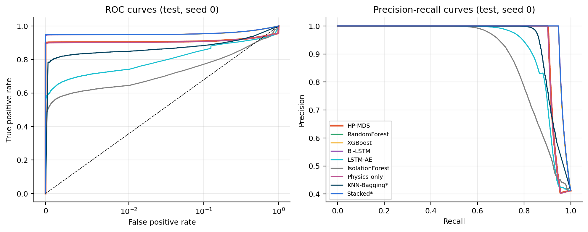

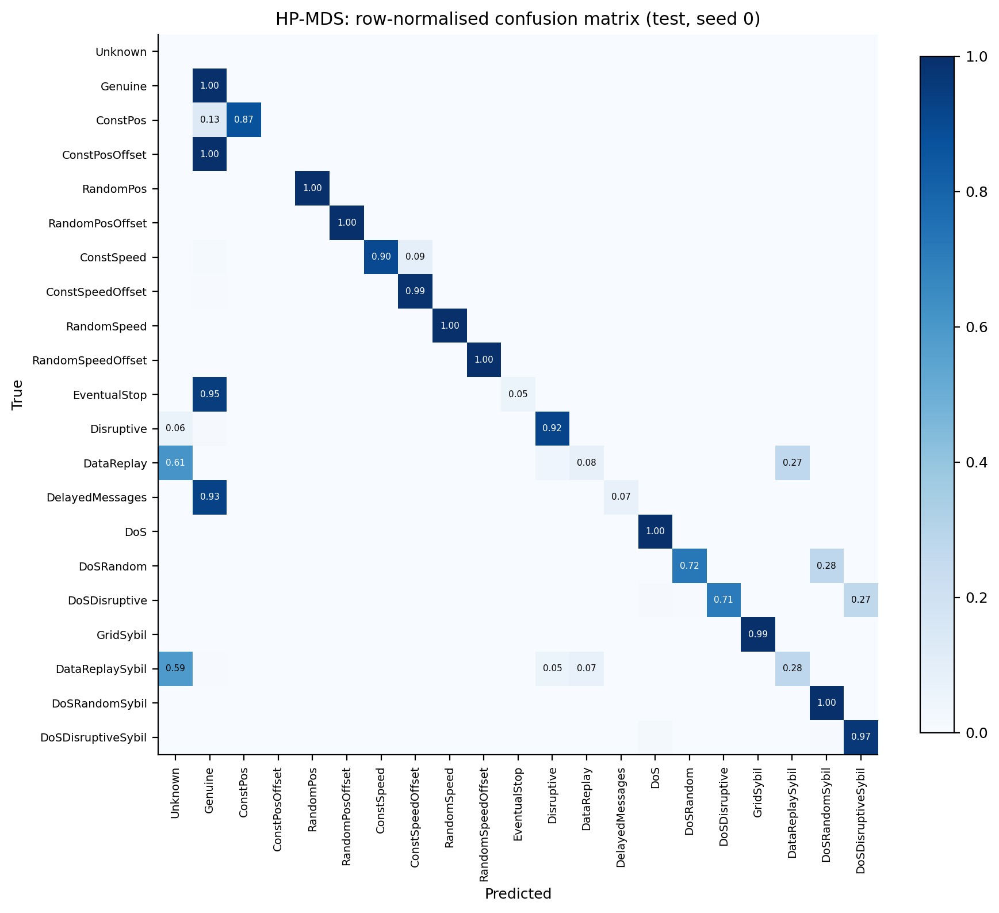

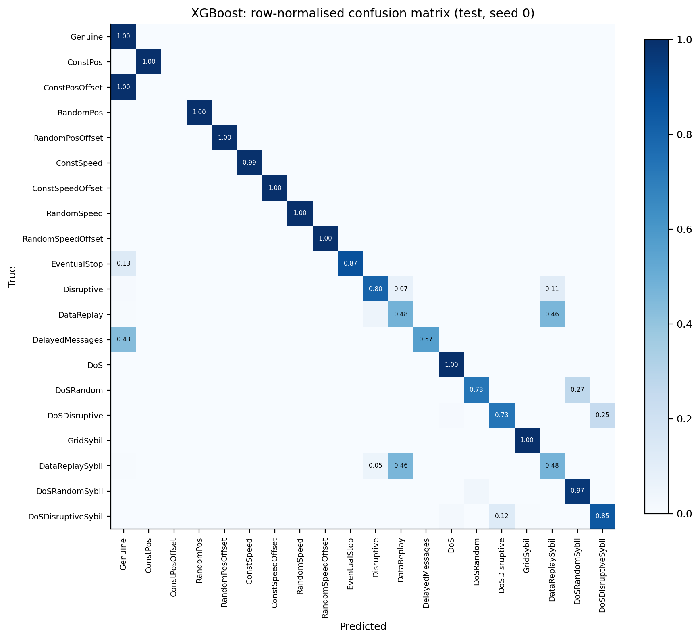

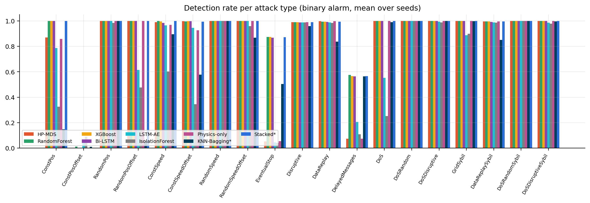

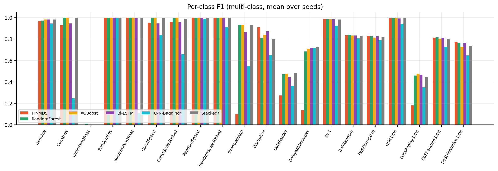

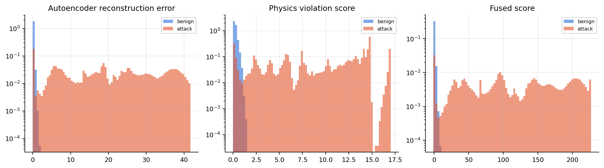

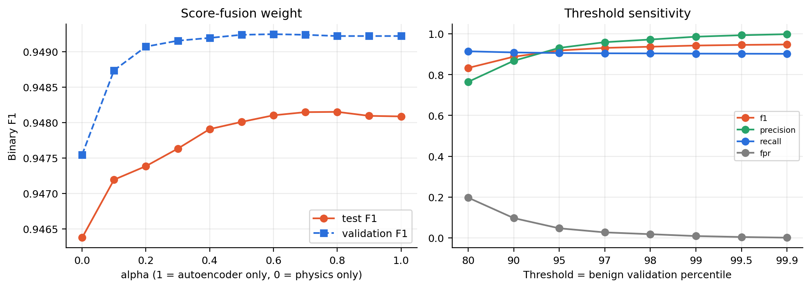

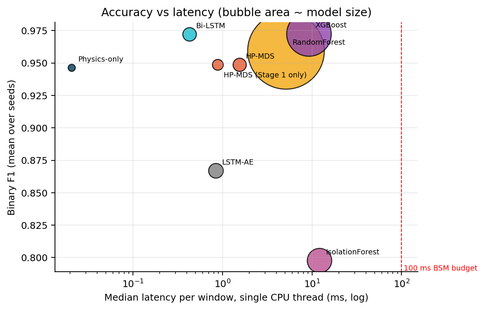

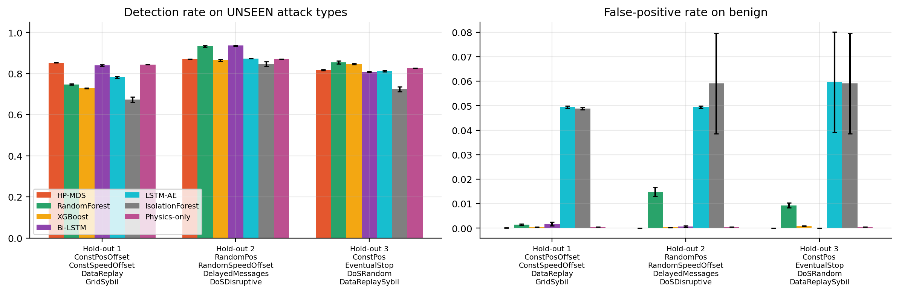

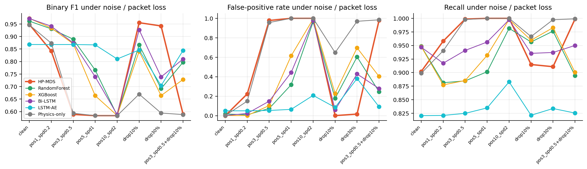

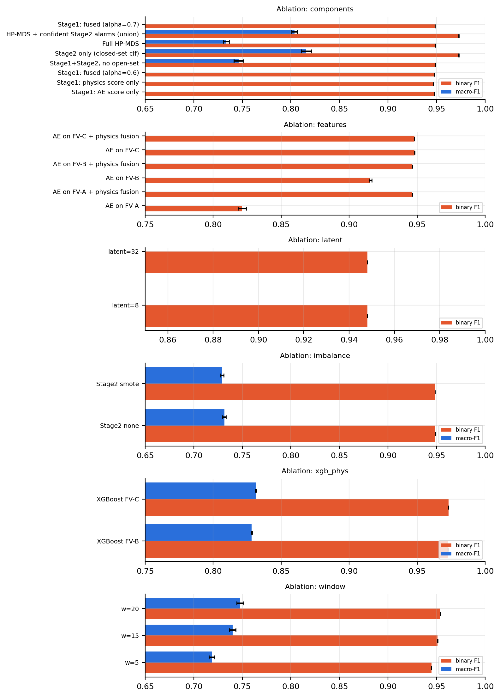

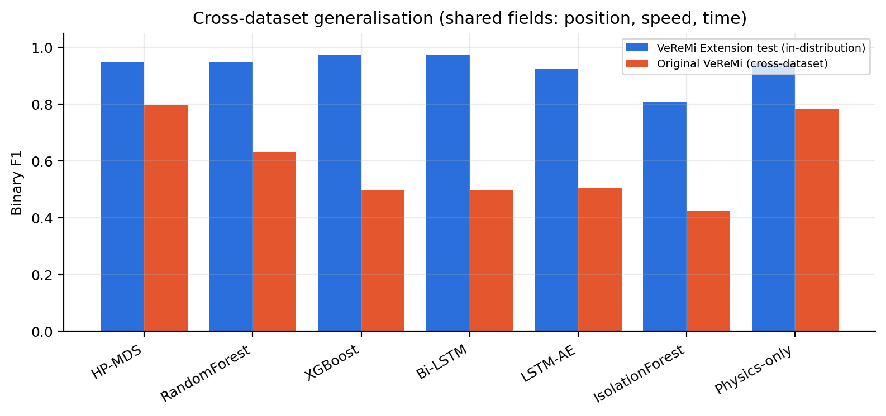

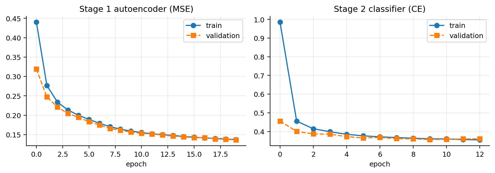

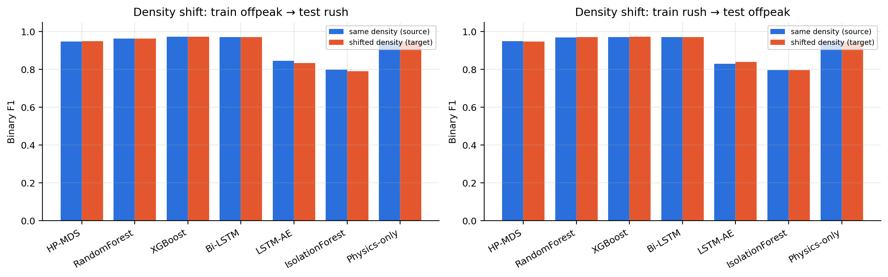

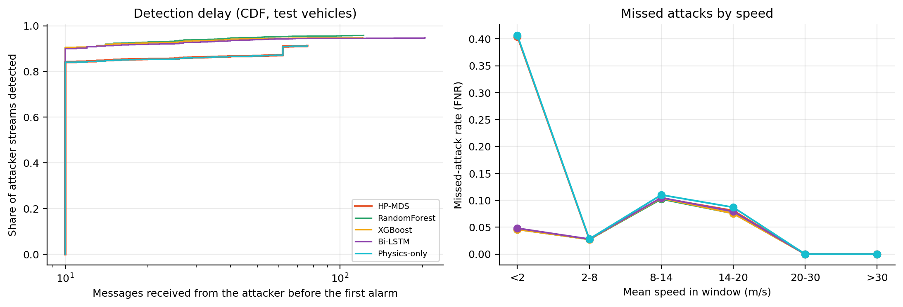
